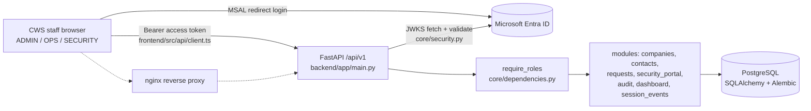
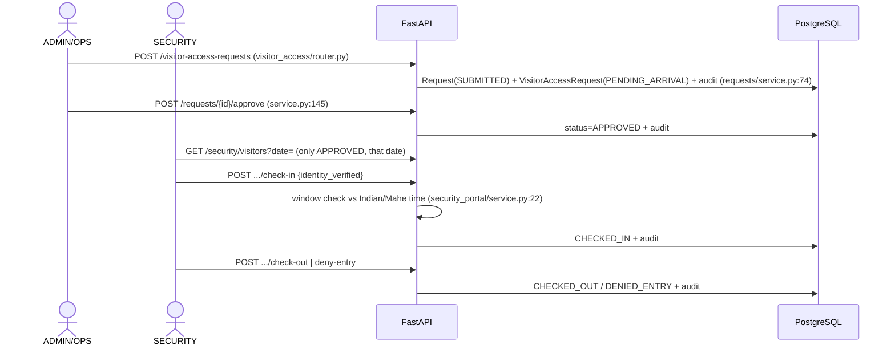
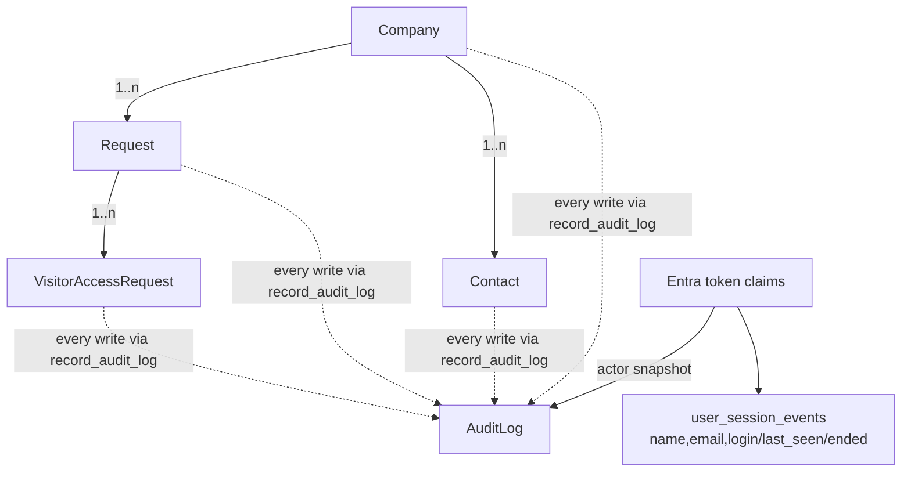

# Data Centre Customer Onboarding — read-only review

> **Latest follow-up:** 119 backend tests and 50 frontend helper tests pass; frontend build passes; four existing lint warnings remain. Owner clarified that session lifecycle/activity belongs only in `user_session_events`: duplicate session audit writes were removed, and normal audit views/totals/exports now exclude historical session audit rows. Business audits and the 15-minute inactivity timeout remain intact. No new migration, deletion, staging, commit, or push was performed for this correction. Migration **202610290023** remains previously applied to local Docker only. VM release and browser/Entra/live concurrency verification remain unverified. Earlier session-audit behavior/counts below describe superseded checkpoints.

> **Historical baseline with follow-up (2026-10-29):** The system map, findings, backlog, and coverage below describe the original review, not today's completion status. See `PEER_REVIEW_FINDINGS.md`, **Current implementation status**, for the maintained checklist. Local fixes include ADMIN-only approval, minimized Security fields, audit pagination/export, explicit site-time Security button checks, parent-first workflow locks, Security detail visibility, and session-role/audit compliance. There are **95 passing backend tests and 21 passing frontend helper tests**; frontend build passes and lint has four existing hook-dependency warnings. Remote CI and live integration/concurrency verification remain pending. The original "no tests", 21-migration, and clean-working-tree statements below are historical. There are now 22 migration files; these latest follow-up fixes require no additional migration. No VM deployment status is asserted here.

Repo: https://github.com/NimalSivakumar/Data-Centre-Customer-Onboarding.git
Clone: project root · branch `main` · HEAD `b042e7d44573977afd3557a5ef8b92e47cff67d4` (2026-09-29, "Merge PR #11 feature/entra-login-integration") · working tree clean · 24 commits, 2 authors.

## 1. What it is
FastAPI + PostgreSQL backend, React 19/Vite/TS frontend (Bootstrap, MSAL). Microsoft Entra ID is the only login; only CWS staff sign in. Roles come from Entra *app-role claims* (ADMIN, OPS, SECURITY), not the DB. Customers = `Company` + `Contact` rows; they have **no login and cannot submit requests**.

Actual flow: ADMIN/OPS create company + contacts -> ADMIN/OPS create a visitor-access request on the company's behalf (one or many visitors, host must be an active contact) -> ADMIN/OPS approve/reject/cancel -> SECURITY sees only APPROVED visitors for a chosen date, verifies identity, checks in/out or denies entry -> every state change writes an audit row.

## 2. Map (verified in source unless marked)
| Subsystem | Key files |
|---|---|
| App/bootstrap | backend/app/main.py (routers under /api/v1, CORS, startup thread) |
| Auth | core/security.py `decode_entra_token` (JWKS RS256, aud, iss, tid, ver, scp, azp); core/dependencies.py `get_current_principal`, `require_roles` |
| Companies | modules/companies/{router,service,models,schemas}.py |
| Contacts | modules/contacts/* |
| Requests (approval) | modules/requests/{router,service}.py; modules/visitor_access/{router,schemas,models}.py |
| Security portal | modules/security_portal/{router,service}.py (check-in window, status machine) |
| Audit | modules/audit/* (actor snapshot from Entra claims, JSON metadata) |
| Dashboard | modules/dashboard/* |
| Session tracking | modules/session_events/*, routes in auth/router.py (`/auth/sessions*`) |
| DB | db/session.py, 21 Alembic migrations (single linear chain) |
| Frontend | src/App.tsx (MSAL, session heartbeat), api/client.ts, layout/navigation.ts, pages/{dashboard,companies,contacts-users,requests,visitor-request,security,audit} |
| Ops | docker-compose.yml, .github/workflows/{ci,deploy-staging}.yml, scripts/linux/*.sh (tarball -> rsync -> alembic -> systemd restart -> verify) |
| Docs | README.md, DOCKER.md, backend/API_ENDPOINTS.txt, ENTRA_ONLY_APPLICATION_RESTRUCTURE_PLAN.md (spec) |

Inferred, not verified: Entra app-role assignment, nginx config, systemd unit, production env values (none in repo).

## 3. Diagrams
Legend: solid = verified call/route in source; dotted = inferred (config outside repo).

### System

### Request -> approval -> security workflow

### Data flow / entities

## 4. Findings (re-scoped: internal VM + Entra + self-hosted runner)
Not reported as defects because they are supplied or controlled outside the repo: env/secret values, Entra scope/tenant/client settings, nginx/systemd, CORS/network exposure, dev-only Docker `--reload`, committed Entra IDs in README, deploy-host hardening. They cannot be checked off-network.

### Confirmed defects (source-verified)
1. PATCH /contacts/{id} returns 500 on any real change: contacts/service.py:84 reads `contact.user`, which `Contact` no longer has (column dropped in migration 0011). The Contacts page edit form hits this.
2. Site-time inconsistency: dashboard uses `date.today()` (dashboard/router.py), SecurityPage.tsx defaults the date with `toISOString()` (UTC), session_events hardcodes the zone, while security_portal uses `settings.site_timezone`. Wrong day 00:00-04:00 local if the VM clock/zone is UTC (VM zone unverified).
3. api/client.ts 401 handler does `window.location.assign('/login')`, ignoring the `/dc-onboarding/` base path used in the deploy build.
4. generate_request_number uses count+1 (requests/service.py:20): concurrent creates collide on the unique index.
5. README and API_ENDPOINTS.txt describe removed features (seed users, password login, users endpoints, customer dashboard).
6. Frontend vestiges: "My Requests" title and `page: ContactsUsersPageMode` prop, "contacts-users" naming, left over from the pre-Entra design.

### Business-rule gaps
7. Requester can also approve (no separation of duties); customers cannot submit, staff do it for them. The plan doc says this is intended; your original description suggests otherwise, so confirm.
8. create_visitor_access_request accepts past visit dates and SUSPENDED/CLOSED companies; host matched by name string; `is_authorised_requester` unused; EXPIRED and NO_SHOW never set (no job). Approve has no confirmation or notes in the UI.
9. Security list returns full ID number/address/phone/email for all approved visitors that day; reads are not audited. Internal network does not remove need-to-know, so treat as a policy decision (masking, view audit).
10. Audit table is ordinary and mutable; audit metadata duplicates full company/contact payloads.
11. Session "timeout" only marks rows ended; it does not end the Entra session or invalidate tokens.
12. No row locking on check-in/out; deny-entry ignores request status; ILIKE search does not escape % and _; duplicate customer_code on company create probably surfaces as a 500 (inferred).
13. No tests. CI lints/builds the frontend and imports the backend only.

## 5. Backlog
| # | Item | Impact | Effort |
|---|---|---|---|
| Q1 | Remove `contact.user` from audit metadata | High | 5 min |
| Q2 | Site timezone everywhere | Med | 1 h |
| Q3 | 401 redirect respects base path | Med | 15 min |
| Q4 | Validate visit_date >= today and company ACTIVE | High | 1 h |
| Q5 | Refresh README / API_ENDPOINTS, drop vestiges | Med | 1 h |
| M1 | pytest suite (role matrix, status machines, check-in window) + CI job with Postgres service on the runner | High | 2-3 d |
| M2 | DB sequence for request numbers; row locks on check-in | Med | 0.5 d |
| M3 | Audit security-portal reads; PII masking policy | Med-High | 2 d |
| M4 | Decide requester != approver | High (policy) | 0.5-1 d |
| L1 | Customer-submitted requests (needs customer identity design) | High | 1-2 wk |
| L2 | Expiry/no-show job; real session invalidation | Med | 2-3 d |

## 6. Coverage and uncertainty
Read in full: all backend code, config, Dockerfile/compose, CI/deploy workflows and all three release scripts, frontend App/auth/api/navigation/Shell, Requests, VisitorRequest, ContactsUsers and Security pages, README/DOCKER/API_ENDPOINTS.
Not read in full: Companies, Dashboard and Audit pages, components, CSS, 20 of 21 migrations (0011 only), plan doc beyond its first ~60 lines (headings only), other branches.
Not verifiable off-network: Entra role assignment, VM time zone, runner-injected variables, DB contents, running app.
Checks run: git clone/status/log; ast.parse of 75 backend .py files (all OK). No tests exist; no install, lint, build, startup or migration run.
